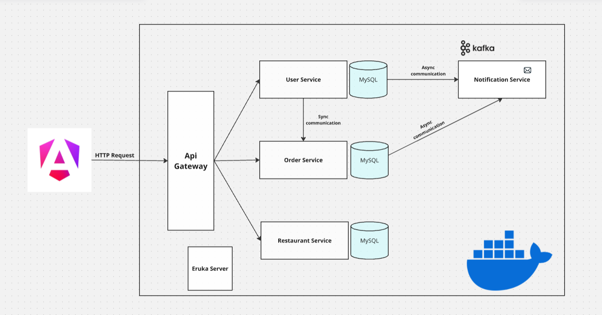
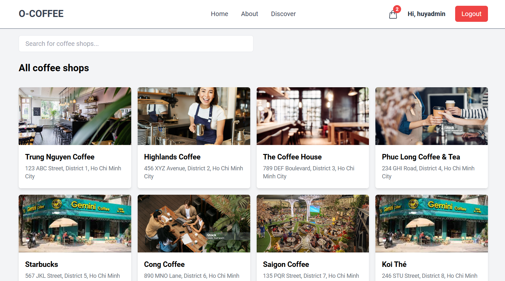
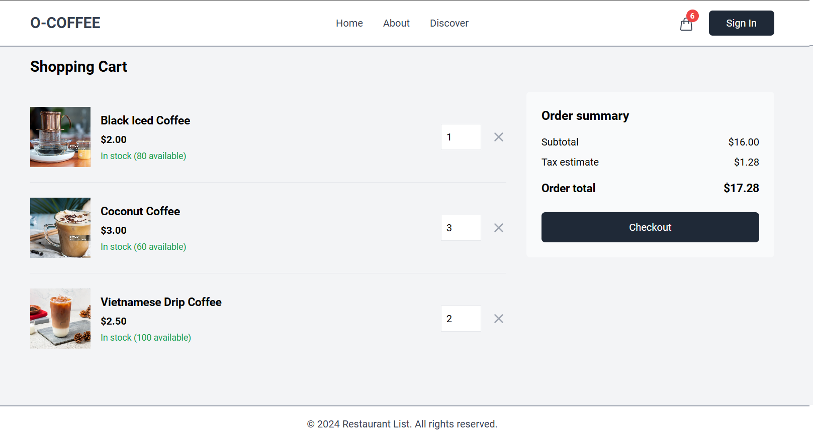
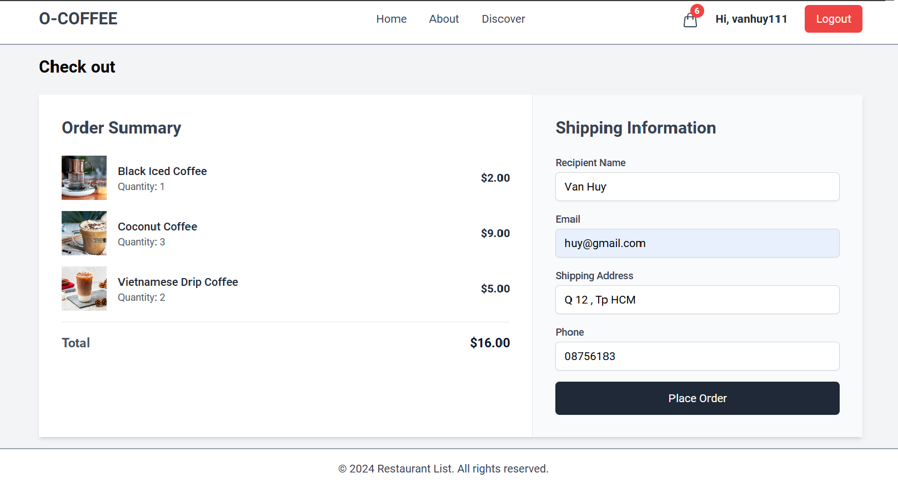
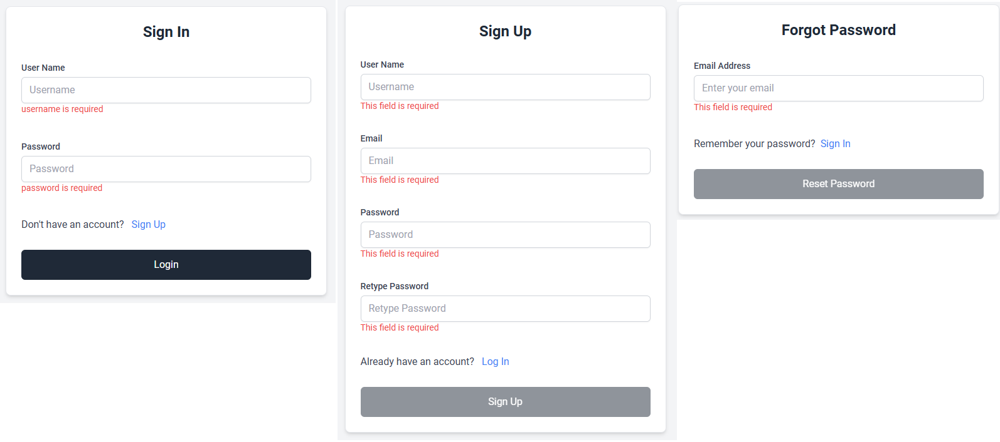
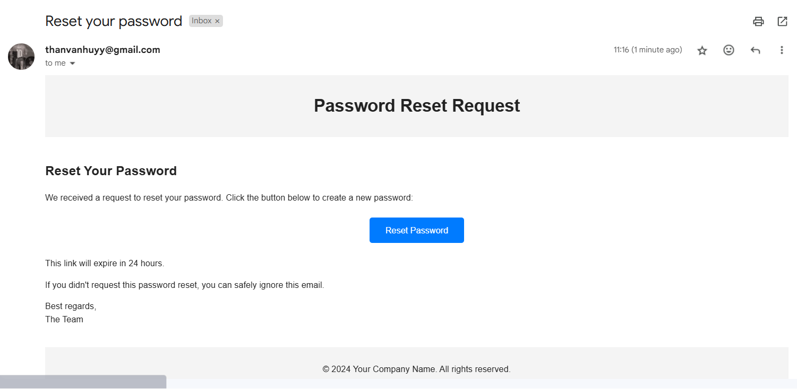

# Spring Boot Microservices — Food Order

Food delivery system built as Spring Boot microservices + Angular frontend.

**Offline-first layout:** payloads under `offline-kit\`. Install WSL + Docker by hand from `offline-kit\prereqs\`, then `setup.cmd` and `start.cmd`.

Docker runs **only infrastructure** (MySQL, Redis, Kafka, Zookeeper). Apps run from `.runtime\`.

## Quick start (fresh / offline PC)

See **[Full_Guide.md](./Full_Guide.md)** (`offline-kit\prereqs\` → WSL MSI + Docker installer, then):

```bat
setup.cmd
start.cmd
```

Open http://localhost:4200 — `user` / `user123` · `admin` / `admin123`

| Command | Purpose |
| --- | --- |
| `setup.cmd` | Expand `offline-kit\*.zip` → `.runtime\` |
| `install-docker.cmd` | Optional shortcut for WSL + Docker installers |
| `build.cmd` | Offline compile (`mvn -o`) and copy jars into `.runtime\app` |
| `start.cmd` | Load images, start infra + local apps |
| `stop.cmd` | Stop apps + infra |
| `status.cmd` | Show which ports are up |
| `clean.cmd` | Delete `.runtime`, `node_modules`, `target`, logs (keeps `offline-kit`) |
| `pack-offline-kit.cmd` | Rebuild `offline-kit\*.zip` on an online machine |

## Architecture



| Service | Port |
| --- | --- |
| Frontend | 4200 |
| API Gateway | 9000 |
| Eureka | 8761 |
| User | 8081 |
| Restaurant | 8082 |
| Order | 8083 |
| Notification | 8084 |

## Repo layout

| Path | Role |
| --- | --- |
| `offline-kit\` | Zipped JDKs, Node, Docker installer, infra images, app payload — **keep in git** |
| `.runtime\` | Expanded by `setup.cmd` — **gitignored** (folder kept via `.gitkeep`) |
| `*/src` | Service source |
| `frontend\` | Angular source (runtime uses `.runtime\app\frontend`) |
| `pack-offline-kit.cmd` | Rebuild `offline-kit` on an online machine |

## Technologies

- Java 8+ bytecode / Spring Boot 2.7, Spring Cloud
- MySQL, Redis, Kafka
- Angular 17 + Tailwind
- Docker Compose for infra only

## Screenshots







See [detail.md](./detail.md) for a deeper system analysis.
